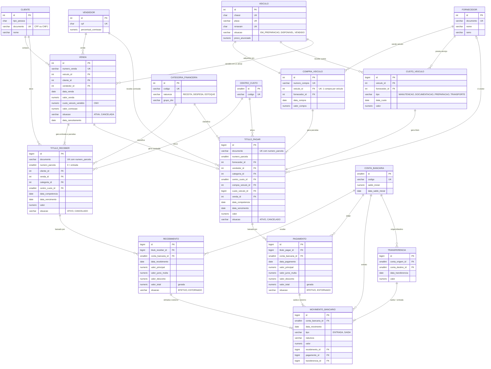
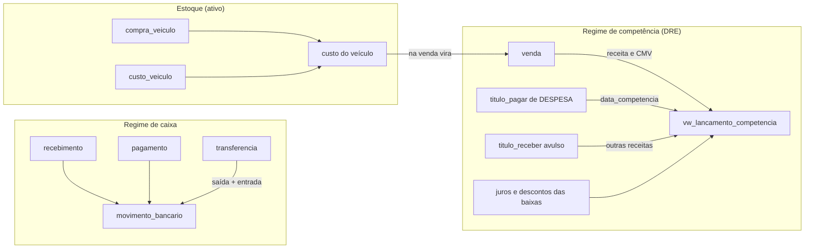

# Diagrama de relacionamentos

Diagrama em [Mermaid](https://mermaid.js.org/) (o GitHub renderiza automaticamente). Para manter a leitura, cada entidade mostra as chaves e as colunas principais; a lista completa está em [`data_dictionary.md`](data_dictionary.md).

A tabela `configuracao` (linha única com a data de referência) não tem relacionamentos e foi omitida.

## Como ler os fluxos

- A **compra** e os **custos** do veículo formam o custo em estoque; só chegam à DRE como **CMV** na data da venda.
- A **venda** é a única origem da receita de veículos. Suas parcelas (`titulo_receber`) são direitos a receber, e os recebimentos são caixa: nenhum dos dois gera receita de novo.
- Todo dinheiro passa por `movimento_bancario`, que é a única fonte dos relatórios de caixa.
